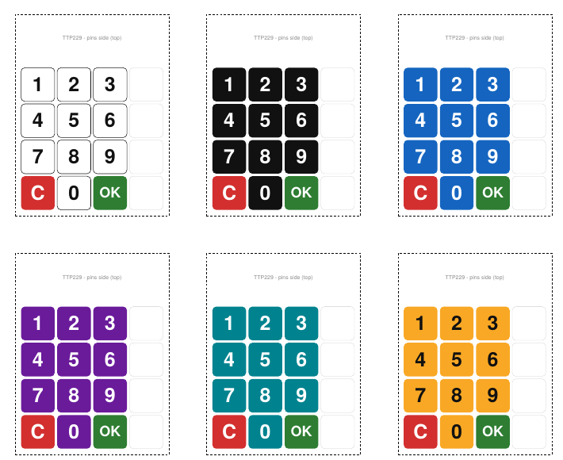

# TTP229 Keypad Overlay

Printable numeric keypad overlay for the **TTP229 16-key capacitive touch module** (49.3 × 64.5 mm).
Print it, cut it out and stick it on the board to turn the module into a numpad.

## Download

[TTP229_keypad_overlay.pdf](TTP229_keypad_overlay.pdf) — A4 page, 6 copies in different colors.

## How to print

1. Paper size: **A4**
2. Scale: **100% / Actual size** (do **not** use "Fit to page")
3. Check the ruler at the bottom of the page — it must measure exactly **100 mm**.
4. Cut along the dashed line. The pin header side goes at the top.

Tip: cover it with clear tape or laminate it. Thin paper does not affect capacitive touch.

## Key mapping

| Module key | Function |
|---|---|
| 1, 2, 3 | 1, 2, 3 |
| 5, 6, 7 | 4, 5, 6 |
| 9, 10, 11 | 7, 8, 9 |
| 14 | 0 |
| 13 | C (clear) |
| 15 | OK (confirm) |
| 4, 8, 12, 16 | not used |

Key numbers are 1-based as printed on the board. If your library numbers keys 0–15, subtract 1.

## Dimensions

- Board: 49.3 × 64.5 mm
- Key pitch: ~11.6 mm, key size ~10.8 mm

Board size is from seller specifications; key pitch is calculated from the board width. Test-fit one copy before gluing.
