# TTP229 Keypad Overlays

Printable keypad overlays for the **TTP229 16-key capacitive touch module** (49.3 × 64.5 mm).
Print, cut out and stick on the board to turn the module into a numpad, calculator, remote, game pad and more.

## Layouts

Each PDF is one A4 page with 6 copies in different colors (white, black, blue, purple, teal, yellow).
[`all_layouts.pdf`](all_layouts.pdf) has one copy of every layout, handy for trying them out.

| | | |
|:-:|:-:|:-:|
| **Numpad (original)**<br><a href="layouts/01-numpad.pdf">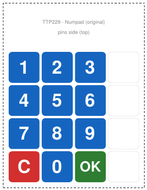</a><br>[PDF](layouts/01-numpad.pdf) | **Calculator**<br><a href="layouts/02-calculator.pdf">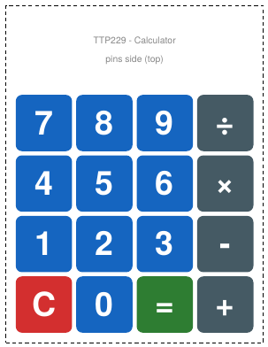</a><br>[PDF](layouts/02-calculator.pdf) | **Classic 4x4 keypad**<br><a href="layouts/03-matrix-4x4.pdf">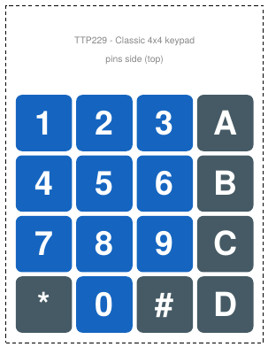</a><br>[PDF](layouts/03-matrix-4x4.pdf) |
| **Hexadecimal 0-F**<br><a href="layouts/04-hex.pdf">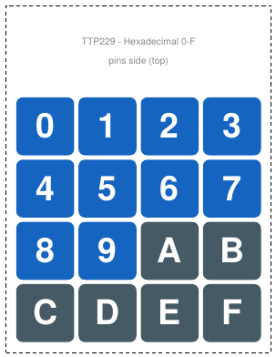</a><br>[PDF](layouts/04-hex.pdf) | **Phone + menu**<br><a href="layouts/05-phone-menu.pdf">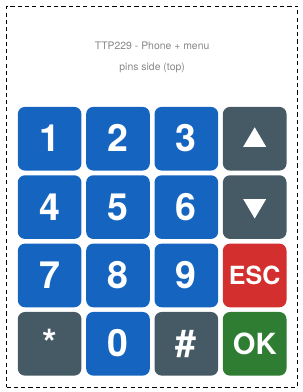</a><br>[PDF](layouts/05-phone-menu.pdf) | **Alarm / door lock**<br><a href="layouts/06-alarm-lock.pdf">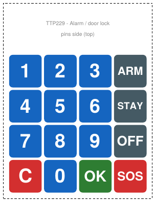</a><br>[PDF](layouts/06-alarm-lock.pdf) |
| **Smart home**<br><a href="layouts/07-smart-home.pdf">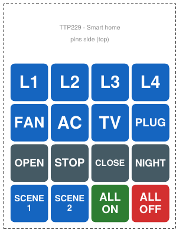</a><br>[PDF](layouts/07-smart-home.pdf) | **Game pad**<br><a href="layouts/08-gamepad.pdf">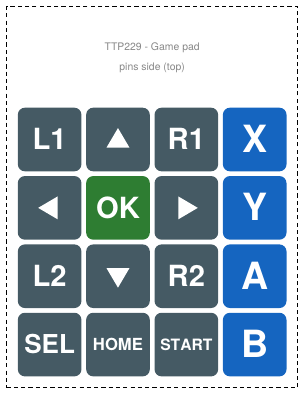</a><br>[PDF](layouts/08-gamepad.pdf) | **Media remote**<br><a href="layouts/09-media.pdf">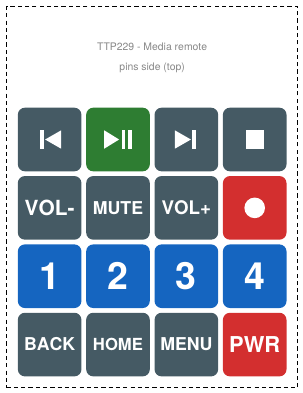</a><br>[PDF](layouts/09-media.pdf) |
| **Elevator panel**<br><a href="layouts/10-elevator.pdf">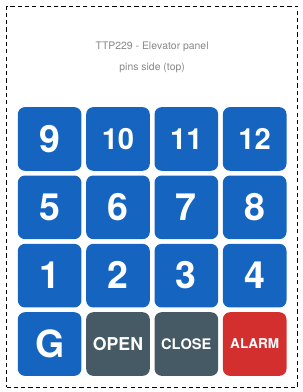</a><br>[PDF](layouts/10-elevator.pdf) | **Music notes**<br><a href="layouts/11-music.pdf">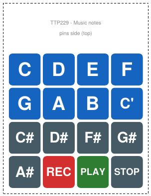</a><br>[PDF](layouts/11-music.pdf) |  |

## How to print

1. Paper size: **A4**
2. Scale: **100% / Actual size** (do **not** use "Fit to page")
3. Check the ruler at the bottom of the page — it must measure exactly **100 mm**.
4. Cut along the dashed line. The pin header side goes at the top.

Tip: cover it with clear tape or laminate it. Thin paper does not affect capacitive touch.

## Key mapping

Module keys are numbered 1–16 as printed on the board (row by row, top-left = 1).
If your library numbers keys 0–15, subtract 1.

<details><summary><b>Numpad (original)</b></summary>

| Key | Function | Key | Function | Key | Function | Key | Function |
|:-:|:-:|:-:|:-:|:-:|:-:|:-:|:-:|
| 1 | 1 | 2 | 2 | 3 | 3 | 4 | — |
| 5 | 4 | 6 | 5 | 7 | 6 | 8 | — |
| 9 | 7 | 10 | 8 | 11 | 9 | 12 | — |
| 13 | C | 14 | 0 | 15 | OK | 16 | — |

</details>

<details><summary><b>Calculator</b></summary>

| Key | Function | Key | Function | Key | Function | Key | Function |
|:-:|:-:|:-:|:-:|:-:|:-:|:-:|:-:|
| 1 | 7 | 2 | 8 | 3 | 9 | 4 | ÷ |
| 5 | 4 | 6 | 5 | 7 | 6 | 8 | × |
| 9 | 1 | 10 | 2 | 11 | 3 | 12 | - |
| 13 | C | 14 | 0 | 15 | = | 16 | + |

</details>

<details><summary><b>Classic 4x4 keypad</b></summary>

| Key | Function | Key | Function | Key | Function | Key | Function |
|:-:|:-:|:-:|:-:|:-:|:-:|:-:|:-:|
| 1 | 1 | 2 | 2 | 3 | 3 | 4 | A |
| 5 | 4 | 6 | 5 | 7 | 6 | 8 | B |
| 9 | 7 | 10 | 8 | 11 | 9 | 12 | C |
| 13 | * | 14 | 0 | 15 | # | 16 | D |

</details>

<details><summary><b>Hexadecimal 0-F</b></summary>

| Key | Function | Key | Function | Key | Function | Key | Function |
|:-:|:-:|:-:|:-:|:-:|:-:|:-:|:-:|
| 1 | 0 | 2 | 1 | 3 | 2 | 4 | 3 |
| 5 | 4 | 6 | 5 | 7 | 6 | 8 | 7 |
| 9 | 8 | 10 | 9 | 11 | A | 12 | B |
| 13 | C | 14 | D | 15 | E | 16 | F |

</details>

<details><summary><b>Phone + menu</b></summary>

| Key | Function | Key | Function | Key | Function | Key | Function |
|:-:|:-:|:-:|:-:|:-:|:-:|:-:|:-:|
| 1 | 1 | 2 | 2 | 3 | 3 | 4 | Up |
| 5 | 4 | 6 | 5 | 7 | 6 | 8 | Down |
| 9 | 7 | 10 | 8 | 11 | 9 | 12 | ESC |
| 13 | * | 14 | 0 | 15 | # | 16 | OK |

</details>

<details><summary><b>Alarm / door lock</b></summary>

| Key | Function | Key | Function | Key | Function | Key | Function |
|:-:|:-:|:-:|:-:|:-:|:-:|:-:|:-:|
| 1 | 1 | 2 | 2 | 3 | 3 | 4 | ARM |
| 5 | 4 | 6 | 5 | 7 | 6 | 8 | STAY |
| 9 | 7 | 10 | 8 | 11 | 9 | 12 | OFF |
| 13 | C | 14 | 0 | 15 | OK | 16 | SOS |

</details>

<details><summary><b>Smart home</b></summary>

| Key | Function | Key | Function | Key | Function | Key | Function |
|:-:|:-:|:-:|:-:|:-:|:-:|:-:|:-:|
| 1 | L1 | 2 | L2 | 3 | L3 | 4 | L4 |
| 5 | FAN | 6 | AC | 7 | TV | 8 | PLUG |
| 9 | OPEN | 10 | STOP | 11 | CLOSE | 12 | NIGHT |
| 13 | SCENE 1 | 14 | SCENE 2 | 15 | ALL ON | 16 | ALL OFF |

</details>

<details><summary><b>Game pad</b></summary>

| Key | Function | Key | Function | Key | Function | Key | Function |
|:-:|:-:|:-:|:-:|:-:|:-:|:-:|:-:|
| 1 | L1 | 2 | Up | 3 | R1 | 4 | X |
| 5 | Left | 6 | OK | 7 | Right | 8 | Y |
| 9 | L2 | 10 | Down | 11 | R2 | 12 | A |
| 13 | SEL | 14 | HOME | 15 | START | 16 | B |

</details>

<details><summary><b>Media remote</b></summary>

| Key | Function | Key | Function | Key | Function | Key | Function |
|:-:|:-:|:-:|:-:|:-:|:-:|:-:|:-:|
| 1 | Previous | 2 | Play/Pause | 3 | Next | 4 | Stop |
| 5 | VOL- | 6 | MUTE | 7 | VOL+ | 8 | Record |
| 9 | 1 | 10 | 2 | 11 | 3 | 12 | 4 |
| 13 | BACK | 14 | HOME | 15 | MENU | 16 | PWR |

</details>

<details><summary><b>Elevator panel</b></summary>

| Key | Function | Key | Function | Key | Function | Key | Function |
|:-:|:-:|:-:|:-:|:-:|:-:|:-:|:-:|
| 1 | 9 | 2 | 10 | 3 | 11 | 4 | 12 |
| 5 | 5 | 6 | 6 | 7 | 7 | 8 | 8 |
| 9 | 1 | 10 | 2 | 11 | 3 | 12 | 4 |
| 13 | G | 14 | OPEN | 15 | CLOSE | 16 | ALARM |

</details>

<details><summary><b>Music notes</b></summary>

| Key | Function | Key | Function | Key | Function | Key | Function |
|:-:|:-:|:-:|:-:|:-:|:-:|:-:|:-:|
| 1 | C | 2 | D | 3 | E | 4 | F |
| 5 | G | 6 | A | 7 | B | 8 | C' |
| 9 | C# | 10 | D# | 11 | F# | 12 | G# |
| 13 | A# | 14 | REC | 15 | PLAY | 16 | STOP |

</details>

## Dimensions

- Board: 49.3 × 64.5 mm
- Key pitch: ~11.6 mm, key size ~10.8 mm

Board size is from seller specifications; key pitch is calculated from the board width. Test-fit one copy before gluing.

## Make your own

Edit `LAYOUTS` in [`generate.py`](generate.py) and run:

```
pip install reportlab
python3 generate.py
```
